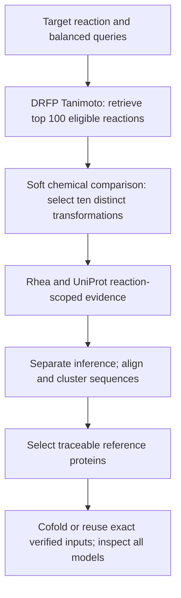

# Current reaction-to-enzyme pipeline

The target is free adipate + hexamethylenediamine (HMDA) → an amide diad. The current output is a ten-reaction evaluation panel and its reference enzymes. [Current results](docs/COLLABORATOR_RESPONSE.md).

## 1. Starting from the target reaction

Construct balanced mechanistic queries using the same normalized ModelSEED structures and proton convention as the corpus. Native ATP → AMP + PPi and ATP → ADP + Pi turnover determine the matched query. Cofactors and stoichiometric multiplicities remain in every scored equation. Direct condensation and adipyl-CoA aminolysis remain separate optional query framings; the latter uses an activated donor.

The pinned corpus contains 33,359 encoded reactions. Excluding 113 zero hybrid vectors leaves 33,246 searchable reactions. Reconstruct product amide cuts and match the amine-bearing fragment to a free-amine reactant; substrate/representation and balance checks identify 480 eligible amidations.

**DRFP–Tanimoto retrieves their top 100.** Each reaction also has 2,048 signed Morgan/ECFP4 count-difference features concatenated with 2,048 DRFP bits. Cosine of the normalized 4,096-feature vector breaks DRFP ties. RXNFP cosine is a separate diagnostic, not the chemical-selection criterion.

## 2. Chemically selecting ten within the retrieved 100

The final ten are chemically selected, rather than the first ten fingerprint hits. The free-acid/primary-amine branch checks a reconstructed carboxylic-acid donor, a reacting carbon-bound primary amine, at least one new amide, and valid substrate copies. AB self-condensation is permitted when the equation contains the required copies.

**No requirement for a diacid, diamine, retained product ends, acyclic substrates or nonaromatic substrates is imposed.** Monoacids, monoamines, ω-amino acids, aromatic/cyclic substrates and multiple amidations remain eligible. Secondary-amine acylation and activated-donor-only reactions remain outside this particular branch.

The soft chemical policy compares:

| Component | Weight | Structural interpretation |
|---|---:|---|
| Functional architecture | 35% | Literal diacid/diamine pairing, AB self-condensation or other coupling architectures receive different preference credit. |
| Retained ends | 10% | Remaining primary-amine and carboxyl functions indicate potential for further coupling. |
| Carbon spacers | 20% | Compare carbon spacing to adipate/HMDA; intervening heteroatoms are not counted as carbon. |
| Backbone | 15% | Describe ring/aromatic and heteroatom-modified backbone differences without excluding candidates. |
| Size | 20% | Penalize additional substrate scaffold smoothly, without a size veto in this selection stage. |

These are declared chemical judgments, not fitted activity probabilities or evidence about pocket size. Their values and contributions are exported. Chemical resemblance orders the eligible pool; DRFP, hybrid cosine and reaction ID resolve ties. Group duplicate organic transformations before taking ten.

The previous five are a **validation reference only**. Their IDs are read after selection and never added as mandatory members. All five remain in the new ten and throughout the tested component-weight perturbations. [Validation](results/modelseed_nylon_top10/original_five_validation.json).

## 3. Mapping reactions to enzymes

Join exact ModelSEED Rhea aliases to UniProt catalytic-reaction and physiological-direction references. Evidence stays attached to its own annotation. RHEA-COMP participant identifiers cannot establish reaction mappings. Follow every UniProt result page and check release consistency, totals, requested URLs and response hashes.

Where aliases are missing, retrieve an exact MetaCyc/Rhea cross-reference and compare the complete reaction structures. Preserve cofactor stoichiometry and specified stereochemistry. The approved rxn47618 → rxn54616 bridge retains its original equation/evidence provenance. Missing stereochemistry is qualified; a symbolic Rhea participant prevents full structural certification.

EC/name/homology searches expand candidates, requiring ≥30% identity and ≥80% aligned coverage of each protein against an annotated reference. Gene-only hits are rejected. **For rxn09897, related BacD/YwfE records remain candidate inference:** its known alanine–anticapsin reaction is not evidence of an exact Gly+Gly assignment.

## 4. Narrowing protein pools and preparing models

Remove exact sequence duplicates, preferring reviewed, nonfragment records, then accession. CD-HIT produces 99%/95% representative sets with ≥90% coverage of both proteins. Keep all original identifiers and membership; taxonomy alone never collapses proteins. Clustering does not establish interchangeable activity or selectivity.

The current reference panel retains all 12 reaction-annotated proteins. For the reaction without an exact assignment, code selects one related-reaction candidate by matching experimental annotation, review status and accession, preserving the inferred label. A larger sequence-diversity panel is a separate decision.

Each unique selected sequence gets an exact-sequence MSA, fetched in batches or reused only after a sequence/hash check. The comparative protocol is monomeric protein + ATP + Mg + adipate, exact Boltz-2 mode, seed 42 and 50 diffusion samples. Metal/phosphate choices follow the declared AMP/PA or ADP/PG comparison protocol and are not universal native metal stoichiometries.

Existing ensembles are reused only after checking input identity, sequence, MSA and molecular composition. New jobs use the shared Lambda GPU gate, explicit CPU/thread allocation and a resumable queue. Inspect all 50 unique PDB/confidence pairs per protein, verify the actual protein/ATP/Mg/adipate composition and recompute geometry before declaring completion.

## 5. Reproducibility and interpretation

[Reproduce the current case](docs/REPRODUCIBILITY.md) from pinned inputs without an agent intervening between stages. Raw responses, rejected hits, mapping evidence, sequences, cluster memberships, model provenance and code/input hashes remain available. Completed scientific snapshots are preserved.

The [cofold plot](results/top10_cofold/activation_geometry.png) shows proximity-weighted attack angle and harmonic distance. These describe acid-activation poses. They do not establish native assignment, substrate promiscuity, completed amidation, polymerization or yield. Biological assembly and experimental controls remain separate evidence.
