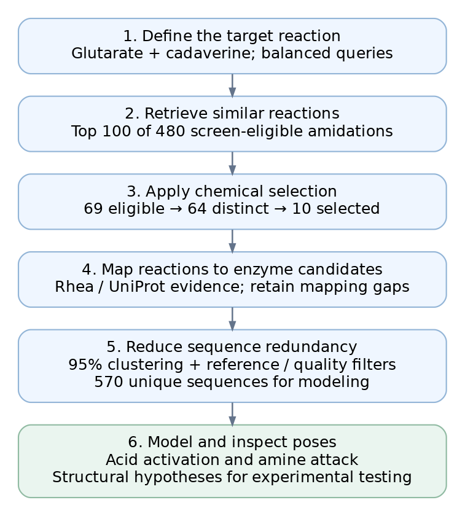

# How we find amide-synthetase candidates for a target reaction

**Goal.** Given a target amide-forming reaction — here, free **glutarate + cadaverine → a glutarate–cadaverine monoamide** (the C5+C5 "nylon-5,5" diad, product `C10H20N2O3`) — prioritize database reactions by fingerprint similarity and declared chemical criteria, then trace their annotations to enzyme candidates for modeling and testing. The monoamide is the search target; polymer formation is not an output of this search.

**Overview.** We first retrieve reactions, then select ten by a reproducible chemical scoring policy, and finally seek proteins with direct reaction annotations or qualified related-reaction/homology support. Some selected reactions remain unmapped. The outputs are a ten-reaction panel, an evidence-labeled protein cohort, and structural predictions where completed.

**Scope.** This document describes the saved `glutarate_cadaverine_fresh_20261102` campaign. Target-specific queries, screening, selection, mapping searches and MSAs were generated independently of previous substrate campaigns. Reference database inputs, software and model weights are shared methods. Counts below refer to this snapshot; they do not describe the current live databases or certify that all prediction jobs have finished.

[Vector image](figures/pipeline_overview/pipeline_overview.svg) · [Editable Mermaid source](figures/pipeline_overview/pipeline_overview.mmd) · [Graphviz rendering source](figures/pipeline_overview/pipeline_overview.dot)

---

## Step 1 — Turn the target into searchable reaction queries

**Intuition:** before we can find "reactions like ours," we write our target reaction in the exact same chemical language as the database, including the energy cofactors.

- Queries are built from normalized ModelSEED structures (glutarate `cpd00379`, cadaverine `cpd01155`) with the same proton convention as the corpus, so our reaction is directly comparable to every stored one.
- We encode the realistic enzymatic framings: **ATP → AMP + PPi** and **ATP → ADP + Pi** turnover. Cofactors remain in the scored equations. Query equations include explicit substrate copies and are balanced before free H+ is removed; corpus encoding limits are described in step 2b.
- Direct condensation and **glutaryl-CoA** aminolysis (`cpd00413`) are encoded as separate comparison queries (the latter uses an activated donor). Step 2 explains how each database reaction is assigned to one of these four framings.

## Step 2 — Retrieve the chemically closest reactions by fingerprint

**Intuition:** turn each reaction into a numerical description of its chemical changes, identify reactions that pass our free-amine acylation screen, and retain the 100 with the most similar fingerprints. No enzyme sequence or enzyme name is used in this ranking.

### 2a. Define the searchable database and eligible pool

For this campaign, the rebuilt ModelSEED corpus contains **33,359 encoded reaction equations**. The builder excludes records marked obsolete or transport, nets coefficients by compound ID, and requires stored structures for the remaining participants. Parseability is not a guarantee of complete chemical specification; symbolic structures can still limit downstream interpretation. Removing 113 all-zero hybrid fingerprints leaves **33,246 searchable reactions**. These are counts for the recorded campaign snapshot, not the size of the entire live ModelSEED database; see the [corpus manifest](results/glutarate_cadaverine_fresh_20261102/results/corpus_manifest.json).

We then ask whether each equation describes acylation of a free amine. The structural screen cuts candidate amide C–N bonds in the products, reconstructs the amine fragment, and checks that it matches an actual reactant after neutralizing N/O charges for this comparison. It validates the particular nitrogen that was acylated and rejects an unchanged spectator. This avoids accepting a reaction merely because an unrelated product contains an amide.

The screen also requires heavy-element balance and a hydrogen/charge discrepancy that can be corrected with protons. It excludes macromolecular modifications, with an exception for recognized polymer elongation. Together, these checks leave **480 screen-eligible amidations**. This is a computational eligibility label, not experimental verification of all 480 reactions.

The screen has a defined scope: it considers acceptors with at most 60 heavy atoms, skips ring amide bonds, and tries up to two simultaneous amide cuts (only single cuts when a product has more than eight candidate amides). Its free-amine pattern accepts eligible primary or secondary amines attached to sp3 carbon. The stricter free-acid/primary-amine criteria are applied in step 3. Thus, the 480 are neither all possible amidations nor already the final chemistry shortlist. See [the structural screen](amide_synthesis/reaction_search/acylation.py) and [fresh-campaign screening logic](amide_synthesis/reaction_search/fresh_campaign.py).

### 2b. Encode the chemical changes

A reaction is written as `reactant1.reactant2>>product1.product2`, with molecular structures expressed as SMILES. The target queries and database equations use the same representation. Cofactors and repeated substrate copies are included in these strings. The corpus omits explicit H+ and records whether the remaining hydrogen and charge differences can be repaired by adding protons; queries are balanced first and then encoded without H+.

The [corpus builder](amide_synthesis/reaction_search/rebuild_corpus.py) rounds each nonzero net coefficient to an integer and limits it to 1–4 copies. Thus, arbitrary database stoichiometry is not preserved exactly. A check against the source tables found **no rounding or capping changes among the 480 eligible reactions** in this campaign (after netting compounds and omitting H+). Balance checks apply to the encoded equations.

**DRFP (Differential Reaction Fingerprint)** extracts local molecular substructures from each side and retains those present on only one side—the symmetric difference. These features are hashed into a fixed-length binary vector, here **2,048 bits**. It provides a compact description of changes in molecular environments without requiring atom mapping.[^drfp]

The pipeline also constructs a 2,048-component Morgan/ECFP4 count vector for each side, using radius-2 atom neighborhoods. Subtracting reactant counts from product counts gives a signed reaction vector. Concatenating this with the DRFP bits produces the **4,096-component hybrid vector** used for tie-breaking. Repeated molecules contribute repeatedly to the count vector; binary DRFP does not retain their multiplicity. See [the fingerprint implementation](amide_synthesis/reaction_search/encode_and_search.py).

### 2c. Match the query framing to each database reaction

All four target queries are scored, but each database reaction receives its ranking score from one query chosen by its cofactor pattern. The following rules are applied in order:

| Database equation contains | Target query used for ranking |
|---|---|
| ATP on the left; AMP and PPi on the right | Glutarate + cadaverine with ATP → AMP + PPi |
| ATP on the left; ADP and Pi on the right | Glutarate + cadaverine with ATP → ADP + Pi |
| CoA on the right but not the left | Glutaryl-CoA + cadaverine aminolysis |
| None of the above | Direct glutarate + cadaverine condensation |

The query is selected by these rules, **not by taking the highest of the four similarity scores**. This aligns the comparison with the recorded cofactor bookkeeping; the fallback does not establish an enzyme mechanism. The assigned query and all four query scores remain in the exported tables. See [`target_route`](amide_synthesis/reaction_search/rank_modelseed_nylon.py) and [the actual target equations](results/glutarate_cadaverine_fresh_20261102/reactions/target_queries.tsv).

### 2d. Rank by DRFP–Tanimoto and retain 100 reactions

For the sets of occupied DRFP bits in the target (`Q`) and database reaction (`R`), Tanimoto similarity is:

`T(Q, R) = number of shared occupied bits / number of occupied bits in either fingerprint`

For example, 30 shared bits out of 60 occupied bits in their union gives `T = 0.50`. Zero means no shared occupied bits; one means identical binary fingerprints, which need not imply identical reactions because distinct features can hash to the same bit.

The deterministic ranking order is:

1. Higher **DRFP–Tanimoto** similarity.
2. For equal DRFP scores, higher **hybrid cosine**, calculated as `dot(x, y) / (norm(x) × norm(y))` on the full 4,096-component vectors.
3. For remaining ties, ascending ModelSEED reaction ID.

The implementation scores and sorts the searchable corpus, filters to the 480 eligible reactions, and retains the first **100**. This is equivalent to ranking the eligible pool directly. It does not take the database-wide top 100 and then screen them. Scoring is an exhaustive vector comparison in this campaign, not an approximate FAISS lookup. RXNFP is not computed by the fresh retrieval stage and has no role in its ranking; any RXNFP scores in supplementary analyses are diagnostic only.

The top-100 boundary is a retrieval budget, not an activity threshold. DRFP is based on a symmetric difference, so reversing a reaction does not change its DRFP; synthesis direction therefore needs the structural screen. Cofactor changes also contribute to the fingerprint, and a high score alone does not establish matching substrates or enzyme activity. These limitations motivate the explicit chemical review in step 3.

### 2e. Inspect the handoff to chemical selection

The [campaign summary](results/glutarate_cadaverine_fresh_20261102/reactions/summary.json) records the funnel **33,246 searchable → 480 eligible → 100 retrieved → 64 chemically eligible distinct transformations → 10 selected**. The last two reductions belong to step 3.

| Output | What a colleague can check |
|---|---|
| [All reaction scores](results/glutarate_cadaverine_fresh_20261102/reactions/all_reaction_scores.tsv) | Database rank, eligibility flag, assigned query and scores |
| [All eligible amidations](results/glutarate_cadaverine_fresh_20261102/reactions/all_eligible_amidations.tsv) | Rank within the 480-reaction pool (`amide_rank`) |
| [Retrieved 100](results/glutarate_cadaverine_fresh_20261102/reactions/retrieved100.tsv) | Exact reaction set passed to step 3 |
| [Selected reactions](results/glutarate_cadaverine_fresh_20261102/reactions/selected_reactions.tsv) | Retrieval rank alongside the later chemical-selection rank |

For a concrete example, glutamate–putrescine ligation (`rxn05123`) uses the ATP→ADP query and has DRFP–Tanimoto **0.4364**, hybrid cosine **0.7424**, and retrieval rank **18/480**. It is retained in the top 100 and subsequently becomes **selection rank 1** under step 3's declared chemical policy. The two ranks answer different questions: fingerprint overlap versus resemblance of the reacting partners to our target.

## Step 3 — Select the final ten by explicit chemistry

**Intuition:** the top 100 are the highest-ranked screen-eligible reactions by fingerprint; we then apply transparent, human-declared chemical judgment to pick the ten most relevant and distinct transformations — we do **not** just take the first ten hits. Of the 100 retrieved reactions, **69 pass the additional chemistry criteria**. Grouping these leaves **64 distinct transformation keys**, from which the top ten are selected and the first five highlighted.

A reaction qualifies for the free-acid/primary-amine branch if it has a real carboxylic-acid donor, a carbon-bound reacting primary amine, a positive net increase in amide-bond count, and valid substrate copies. AB self-condensation means that a monomer carrying both an amine and a carboxyl group couples to another copy of itself; at least two reactant copies must be present.

At this additional selection stage, we impose **no** requirement for a diacid, diamine, retained ends, or an acyclic/nonaromatic scaffold. Monoacids, monoamines, ω-amino acids, ring-containing scaffolds and multiple amidations can qualify if they have already passed step 2. This does not override the earlier sp3-carbon-bound amine pattern, acceptor-size limit, or exclusion of ring amide cuts. (Secondary-amine acylation and activated-donor-only reactions fall outside this branch.)

Among the eligible reactions, a **soft scoring policy** (version `fresh-C5-C5-20261102`) ranks by chemical resemblance to glutarate/cadaverine:

| Component | Weight | What it measures |
|---|---:|---|
| Functional architecture | 35% | How the coupling is built (see credit scale below) |
| Retained ends | 10% | Leftover primary-amine / carboxyl groups → potential for further coupling |
| Carbon spacers | 20% | How closely the carbon chain lengths match glutarate (3-carbon spacer between carboxyls) and cadaverine (5-carbon diamine); heteroatoms don't count as carbon |
| Backbone | 15% | Ring/aromatic/heteroatom backbone differences (described, not used to exclude) |
| Size | 20% | Smooth penalty for extra scaffold — no hard size cutoff at this stage |

Architecture credit scale: diacid + primary diamine = **1.0**, AB self-condensation = **0.8**, amino-acid acceptor = **0.5**, primary-diamine acceptor = **0.3**, other = **0.0**.

The score is the weighted sum of these five credits, with weights and target dimensions recorded in the [campaign configuration](results/glutarate_cadaverine_fresh_20261102/campaign_config.json). These are declared chemical preferences, not fitted activity probabilities or measurements of enzyme pocket size. The [scoring implementation](amide_synthesis/reaction_search/chemical_selection.py) defines the spacer, backbone and size calculations; [the chemical-review table](results/glutarate_cadaverine_fresh_20261102/reactions/chemical_review.tsv) records each component.

Chemical resemblance sets the order; DRFP, hybrid cosine, and reaction ID break ties. Deduplication then retains the first-ranked member of each transformation key. The key removes ATP, AMP, ADP, Pi and PPi from the encoded equation and sorts the remaining species. It groups differences in that bookkeeping only; it is not a general proof that every chemically equivalent reaction has been merged.

The ten selected reactions span glutamate–putrescine ligation (`rxn05123`, EC 6.3.1.11), fumarate–diaminopropionate (`rxn46045`), the MurE D-lysine ligase (`rxn22343`), several citrate/citryl couplings (`rxn42510`, `rxn47618`, `rxn21038`, `rxn45007`), staphyloferrin B formation (`rxn42395`), glycylglycine formation (`rxn09897`) and N-acetyldemethylphosphinothricin tripeptide formation (`rxn13979`). These labels summarize the saved reaction equations; they do not establish enzyme assignments.

> **Independence check (not a constraint):** prior-campaign candidate lists are *not* used during selection. Only after the independent selection is frozen do we compare: the panel is honest about rediscovery vs. novelty (e.g. candidates new to, or absent from, previously checked tables). A different substrate query does not imply zero enzyme overlap.

## Step 4 — Map each reaction to real enzymes

**Intuition:** follow each selected reaction's database identifiers to protein annotations, while distinguishing direct annotation support from candidate inference.

The mapping searches use ModelSEED→Rhea aliases and exact MetaCyc/KEGG cross-references into Rhea. Rhea supplies reaction identities; UniProt supplies protein records and catalytic-activity annotations. Full reaction comparisons retain encoded cofactor copies and specified stereochemistry after protonation normalization. Missing stereochemistry is labeled compatible but underspecified; symbolic participants prevent an exact structural check. RHEA-COMP participant identifiers alone are not accepted as reaction assignments.

| Evidence route | What it supports |
|---|---|
| Matching Rhea ID in a UniProt catalytic-reaction or physiological-direction annotation | Annotation support for the mapped native reaction, subject to the structural comparison and the annotation's own evidence |
| EC or name match plus alignment to a reference | An inferred candidate: at least 30% sequence identity and 80% aligned coverage of **both** candidate and reference, using local BLOSUM62 alignment |
| Reviewed related-reaction annotation where an exact alias is unavailable | A related-activity candidate; it does not establish the retrieved reaction assignment |

Gene-name matches alone do not qualify. Evidence stays attached to its own reaction/direction annotation; neither a reviewed record nor an alignment threshold alone demonstrates activity on glutarate and cadaverine.

The saved search records cover UniProt release **2026_03**. Pagination, total counts, release consistency, exact request URLs and response hashes are checked. Responses originated within this campaign; matching saved responses can be reused within the campaign after URL/hash validation. This is different from reusing a previous substrate campaign's candidate profiles or performing a new live search today. See the [mapping summary](results/glutarate_cadaverine_fresh_20261102/mapping/summary.json), [query snapshots](results/glutarate_cadaverine_fresh_20261102/mapping/query_snapshots.json), and [annotation parser](amide_synthesis/enzyme_mapping/uniprot_snapshot.py).

Two gaps matter when reading the panel. For `rxn09897`, the saved mapping contains **11 related/inferred candidates and no exact native-reaction annotation**; BacD/YwfE-type assignments remain qualified. For `rxn13979`, it contains **zero accepted enzyme candidates**; three records are retained separately as reaction context, not standalone assignments. A selected reaction therefore does not guarantee a mapped enzyme. The [reaction-candidate table](results/glutarate_cadaverine_fresh_20261102/mapping/reaction_candidates.tsv) preserves these distinctions.

## Step 5 — Narrow the protein pools and pick reference proteins

**Intuition:** reduce sequence redundancy while retaining useful annotated references and keeping every candidate traceable to its reaction evidence.

The saved mapping contains **694 unique accessions representing 681 exact sequences**. Exact duplicate sequences are collapsed, preferring reviewed records, then non-fragments, then accession order. CD-HIT at **95% identity**, with at least **90% aligned coverage of both sequences**, yields **574 representatives**. The fresh campaign uses the 95% set; the 99% analyses elsewhere in the project are not an additional step in this cohort's construction.

The modeling cohort retains representatives plus reviewed native/related-reaction references, excludes fragments and sequences containing residues outside the standard 20-amino-acid alphabet, and folds each exact sequence once. The resulting **570 unique sequences** are listed in [the modeling table](results/glutarate_cadaverine_fresh_20261102/mapping/fold_candidates.tsv). The difference between 574 and 570 is the net result of these rules, not simply four discarded clusters.

[Cluster memberships](results/glutarate_cadaverine_fresh_20261102/mapping/cluster_membership.tsv) retain all 694 original identifiers; reaction-to-protein links remain in the separate reaction-candidate table. Taxonomy alone never merges proteins. Clustering reduces redundancy but does not establish interchangeable activity or substrate selectivity. See [the clustering implementation](amide_synthesis/candidate_selection/sequence_redundancy.py).

## Step 6 — Build and inspect structural models

**Intuition:** model candidate proteins with target ligands to examine poses relevant to acid activation and amine attack. These are structural hypotheses for testing.

The [frozen-input summary](results/glutarate_cadaverine_fresh_20261102/aurora/cohort_summary.json) records **570 verified fresh MSAs** (multiple sequence alignments), with no alignment files reused from previous substrate campaigns. Exact query-sequence and file-hash checks connect each alignment to its modeling input.

The two-stage Boltz-2 protocol uses seed **42** and **50 diffusion samples per protein per stage**:

| Modeling stage | Ligands and purpose |
|---|---|
| A — acid activation | Protein + glutarate + ATP + assigned Mg ions |
| B — amine attack | Protein + glutaryl-AMP or glutaryl-phosphate + cadaverine + assigned Mg ions; ADP retained for the phosphate route |

Stage B includes a cadaverine pocket constraint derived from stage A: the builder chooses the pose with the shortest glutarate-O–ATP-P distance, then uses up to 20 protein residues within 7 Å of glutarate to define the pocket. Thus, stage-B localization is partly imposed by the protocol and should not be interpreted as independent evidence of binding. See [the stage-B input builder](amide_synthesis/structure_modeling/aurora_c5_support/build_step2.py).

The setup assigns one Mg to the AMP route and two to the ADP/phosphate route. These are comparative modeling choices, not experimentally verified metal stoichiometries for every protein. Route labels can also inherit the retrieval query when native annotation is unavailable; such assignments remain assumptions. The [target-modeling record](results/glutarate_cadaverine_fresh_20261102/target_modeling_chemistry.json) specifies the target ligands and sampling settings.

The full protocol requests **57,000 structures** (570 × 2 × 50). This is an expected output count, not a completion claim. The Lambda workflow uses shared GPU reservations and a resumable queue; completion requires validating the expected coordinate/confidence pairs and geometry for each stage. This document describes the protocol and frozen cohort, not a fresh audit of all prediction outputs.

---

## Reproducibility and how to read the result

Raw responses, rejected hits, mapping evidence, sequences, cluster memberships and manifests provide the basis for replaying and auditing the saved campaign. See [the campaign report](results/glutarate_cadaverine_fresh_20261102/report.html). Relative links in this document point to the local campaign files; a copy of this Markdown file alone does not include those data.

**Factual review, 2026-11-17.** Counts, score examples, selection rules, sequence filters and modeling settings were checked against the saved tables/configuration and relevant source files. The product formula was independently recalculated as `C10H20N2O3`. All **10 reaction-output hashes and 159 mapping-output hashes** match their recorded manifests. All recorded reaction-stage input hashes also match. However, the current `enzyme_mapping/fresh_campaign.py` differs from its hash in the mapping manifest. The saved mapping results remain internally intact, but exact reproduction with the current mapping code is **not established**. Existing freshness files are dated records, not a substitute for this check; this review did not rerun live discovery or GPU predictions.

Keep the evidence levels separate: fingerprint similarity retrieves reactions; the declared chemical score prioritizes them; database annotations and homology support protein candidates; predicted geometry evaluates modeled poses. None of these alone establishes activity on the target pair, completed amidation, polymerization, or yield. Those conclusions require experimental evidence, including appropriate assembly and activity controls.

[^drfp]: Reymond group. [DRFP algorithm description](https://github.com/reymond-group/drfp/blob/main/README.md).
