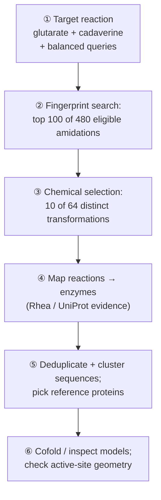

# How we find amide-synthetase candidates for a target reaction

**Goal.** Given a target amide-forming reaction — here, free **glutarate + cadaverine → a glutarate–cadaverine monoamide** (the C5+C5 "nylon-5,5" diad, product `C10H20N2O3`) — find the biochemically most similar reactions already in the database, then trace those reactions back to real enzymes we can model and test.

**In a nutshell.** We don't search for enzymes directly. We search for *reactions* that are chemically closest to our target, pick the ten most relevant ones using explicit, hand-declared chemical criteria, and only then follow each reaction's annotations to the enzymes that catalyze it. The final output is a ten-reaction panel with its reference enzymes and structural models. (This is an **independent campaign**: the corpus, fingerprints, eligibility, mappings and MSAs are all rebuilt from scratch for glutarate/cadaverine — nothing is reused from earlier substrate pairs.)

---

## Step 1 — Turn the target into searchable reaction queries

**Intuition:** before we can find "reactions like ours," we write our target reaction in the exact same chemical language as the database, including the energy cofactors.

- Queries are built from normalized ModelSEED structures (glutarate `cpd00379`, cadaverine `cpd01155`) with the same proton convention as the corpus, so our reaction is directly comparable to every stored one.
- We encode the realistic enzymatic framings: **ATP → AMP + PPi** and **ATP → ADP + Pi** turnover. Cofactors and stoichiometric multiplicities stay in every scored equation.
- Direct condensation and **glutaryl-CoA** aminolysis (`cpd00413`) are encoded as separate comparison queries (the latter uses an activated donor). Step 2 explains how each database reaction is assigned to one of these four framings.

## Step 2 — Retrieve the chemically closest reactions by fingerprint

**Intuition:** turn each reaction into a numerical description of its chemical changes, identify reactions that pass our free-amine acylation screen, and retain the 100 with the most similar fingerprints. No enzyme sequence or enzyme name is used in this ranking.

### 2a. Define the searchable database and eligible pool

For this campaign, the rebuilt ModelSEED corpus contains **33,359 fully representable reaction equations**. Reactions with missing or symbolic structures cannot enter this numerical comparison. Removing 113 all-zero hybrid fingerprints leaves **33,246 searchable reactions**. These are counts for the recorded campaign snapshot, not the size of the entire live ModelSEED database; see the [corpus manifest](results/glutarate_cadaverine_fresh_20261102/results/corpus_manifest.json).

We then ask whether each equation describes acylation of a free amine. The structural screen cuts candidate amide C–N bonds in the products, reconstructs the amine fragment, and checks that it matches an actual reactant after neutralizing N/O charges for this comparison. It validates the particular nitrogen that was acylated and rejects an unchanged spectator. This avoids accepting a reaction merely because an unrelated product contains an amide.

The screen also requires heavy-element balance and a hydrogen/charge discrepancy that can be corrected with protons. It excludes macromolecular modifications, with an exception for recognized polymer elongation. Together, these checks leave **480 screen-eligible amidations**. This is a computational eligibility label, not experimental verification of all 480 reactions.

The screen has a defined scope: it considers acceptors with at most 60 heavy atoms, skips ring amide bonds, and tries up to two simultaneous amide cuts (only single cuts when a product has more than eight candidate amides). Its free-amine pattern accepts eligible primary or secondary amines attached to sp3 carbon. The stricter free-acid/primary-amine criteria are applied in step 3. Thus, the 480 are neither all possible amidations nor already the final chemistry shortlist. See [the structural screen](amide_synthesis/reaction_search/acylation.py) and [fresh-campaign screening logic](amide_synthesis/reaction_search/fresh_campaign.py).

### 2b. Encode the chemical changes

A reaction is written as `reactant1.reactant2>>product1.product2`, with molecular structures expressed as SMILES. The target queries and database equations use the same representation. Cofactors and repeated substrate copies remain in these strings; explicit H+ is removed after balance checks, following the corpus convention.

**DRFP (Differential Reaction Fingerprint)** extracts local molecular substructures from each side and retains those present on only one side—the symmetric difference. These features are hashed into a fixed-length binary vector, here **2,048 bits**. It provides a compact description of changes in molecular environments without requiring atom mapping.[^drfp]

The pipeline also constructs a 2,048-component Morgan/ECFP4 count vector for each side, using radius-2 atom neighborhoods. Subtracting reactant counts from product counts gives a signed reaction vector. Concatenating this with the DRFP bits produces the **4,096-component hybrid vector** used for tie-breaking. Repeated molecules contribute repeatedly to the count vector; binary DRFP does not retain their multiplicity. See [the fingerprint implementation](amide_synthesis/reaction_search/encode_and_search.py).

### 2c. Match the query framing to each database reaction

All four target queries are scored, but each database reaction receives its ranking score from one query chosen by its cofactor pattern. The following rules are applied in order:

| Database equation contains | Target query used for ranking |
|---|---|
| ATP on the left; AMP and PPi on the right | Glutarate + cadaverine with ATP → AMP + PPi |
| ATP on the left; ADP and Pi on the right | Glutarate + cadaverine with ATP → ADP + Pi |
| CoA on the right but not the left | Glutaryl-CoA + cadaverine aminolysis |
| None of the above | Direct glutarate + cadaverine condensation |

The query is selected by these rules, **not by taking the highest of the four similarity scores**. This aligns the comparison with the recorded cofactor bookkeeping; the fallback does not establish an enzyme mechanism. The assigned query and all four query scores remain in the exported tables. See [`target_route`](amide_synthesis/reaction_search/rank_modelseed_nylon.py) and [the actual target equations](results/glutarate_cadaverine_fresh_20261102/reactions/target_queries.tsv).

### 2d. Rank by DRFP–Tanimoto and retain 100 reactions

For the sets of occupied DRFP bits in the target (`Q`) and database reaction (`R`), Tanimoto similarity is:

`T(Q, R) = number of shared occupied bits / number of occupied bits in either fingerprint`

For example, 30 shared bits out of 60 occupied bits in their union gives `T = 0.50`. Zero means no shared occupied bits; one means identical binary fingerprints, which need not imply identical reactions because distinct features can hash to the same bit.

The deterministic ranking order is:

1. Higher **DRFP–Tanimoto** similarity.
2. For equal DRFP scores, higher **hybrid cosine**, calculated as `dot(x, y) / (norm(x) × norm(y))` on the full 4,096-component vectors.
3. For remaining ties, ascending ModelSEED reaction ID.

The implementation scores and sorts the searchable corpus, filters to the 480 eligible reactions, and retains the first **100**. This is equivalent to ranking the eligible pool directly. It does not take the database-wide top 100 and then screen them. Scoring is an exhaustive vector comparison in this campaign, not an approximate FAISS lookup. RXNFP is not computed by the fresh retrieval stage and has no role in its ranking; any RXNFP scores in supplementary analyses are diagnostic only.

The top-100 boundary is a retrieval budget, not an activity threshold. DRFP is based on a symmetric difference, so reversing a reaction does not change its DRFP; synthesis direction therefore needs the structural screen. Cofactor changes also contribute to the fingerprint, and a high score alone does not establish matching substrates or enzyme activity. These limitations motivate the explicit chemical review in step 3.

### 2e. Inspect the handoff to chemical selection

The [campaign summary](results/glutarate_cadaverine_fresh_20261102/reactions/summary.json) records the funnel **33,246 searchable → 480 eligible → 100 retrieved → 64 chemically eligible distinct transformations → 10 selected**. The last two reductions belong to step 3.

| Output | What a colleague can check |
|---|---|
| [All reaction scores](results/glutarate_cadaverine_fresh_20261102/reactions/all_reaction_scores.tsv) | Database rank, eligibility flag, assigned query and scores |
| [All eligible amidations](results/glutarate_cadaverine_fresh_20261102/reactions/all_eligible_amidations.tsv) | Rank within the 480-reaction pool (`amide_rank`) |
| [Retrieved 100](results/glutarate_cadaverine_fresh_20261102/reactions/retrieved100.tsv) | Exact reaction set passed to step 3 |
| [Selected reactions](results/glutarate_cadaverine_fresh_20261102/reactions/selected_reactions.tsv) | Retrieval rank alongside the later chemical-selection rank |

For a concrete example, glutamate–putrescine ligation (`rxn05123`) uses the ATP→ADP query and has DRFP–Tanimoto **0.4364**, hybrid cosine **0.7424**, and retrieval rank **18/480**. It is retained in the top 100 and subsequently becomes **selection rank 1** under step 3's declared chemical policy. The two ranks answer different questions: fingerprint overlap versus resemblance of the reacting partners to our target.

## Step 3 — Select the final ten by explicit chemistry

**Intuition:** the top 100 are the highest-ranked screen-eligible reactions by fingerprint; we then apply transparent, human-declared chemical judgment to pick the ten most relevant and distinct transformations — we do **not** just take the first ten hits. After grouping duplicate transformations, 64 distinct candidates remain, from which ten are chosen (five highlighted).

A reaction qualifies for the free-acid/primary-amine branch if it has a real carboxylic-acid donor, a carbon-bound reacting primary amine, at least one newly formed amide, and valid substrate copies (AB self-condensation is allowed when the stoichiometry supports it).

We deliberately impose **no** requirement for a diacid, diamine, retained ends, or acyclic/nonaromatic substrates. Monoacids, monoamines, ω-amino acids, rings, aromatics and multiple amidations all remain eligible. (Secondary-amine acylation and activated-donor-only reactions fall outside this branch.)

Among the eligible reactions, a **soft scoring policy** (version `fresh-C5-C5`) ranks by chemical resemblance to glutarate/cadaverine:

| Component | Weight | What it measures |
|---|---:|---|
| Functional architecture | 35% | How the coupling is built (see credit scale below) |
| Retained ends | 10% | Leftover primary-amine / carboxyl groups → potential for further coupling |
| Carbon spacers | 20% | How closely the carbon chain lengths match glutarate (3-carbon spacer between carboxyls) and cadaverine (5-carbon diamine); heteroatoms don't count as carbon |
| Backbone | 15% | Ring/aromatic/heteroatom backbone differences (described, not used to exclude) |
| Size | 20% | Smooth penalty for extra scaffold — no hard size cutoff at this stage |

Architecture credit scale: diacid + primary diamine = **1.0**, AB self-condensation = **0.8**, amino-acid acceptor = **0.5**, primary-diamine acceptor = **0.3**, other = **0.0**.

These are **declared chemical judgments, not fitted activity probabilities** and not claims about enzyme pocket size. Every component value is exported for inspection. Chemical resemblance sets the order; DRFP, hybrid cosine, and reaction ID break ties.

The ten selected reactions span glutamate–putrescine ligation (`rxn05123`, EC 6.3.1.11), fumarate–diaminopropionate (`rxn46045`), the MurE D-lysine ligase (`rxn22343`), several citrate/citryl couplings (`rxn42510`, `rxn47618`, `rxn21038`, `rxn45007`), staphyloferrin B formation (`rxn42395`), glycylglycine formation (`rxn09897`) and a phosphinothricin tripeptide ligase (`rxn13979`).

> **Independence check (not a constraint):** prior-campaign candidate lists are *not* used during selection. Only after the independent selection is frozen do we compare: the panel is honest about rediscovery vs. novelty (e.g. candidates new to, or absent from, previously checked tables). A different substrate query does not imply zero enzyme overlap.

## Step 4 — Map each reaction to real enzymes

**Intuition:** now walk from each selected reaction to the proteins known to catalyze it, keeping each piece of evidence tied to its source.

- Join exact ModelSEED→Rhea aliases to UniProt catalytic-reaction and physiological-direction annotations; evidence stays attached to its own annotation. (RHEA-COMP participant IDs alone cannot establish a mapping.) Every UniProt result page is followed, with release/total/URL/response-hash checks. Responses are fetched fresh — no prior mapping profiles are loaded.
- Where a direct alias is missing, we fetch an exact MetaCyc/Rhea cross-reference and compare the *full* reaction structures, preserving cofactor stoichiometry and stereochemistry.
- EC/name/homology searches expand the candidate pool but require **≥30% identity and ≥80% aligned coverage** of each protein against an annotated reference (local BLOSUM62 alignment); gene-only hits are rejected.
- Honest caveats are preserved, not hidden — e.g. for `rxn09897`, BacD/YwfE-type records stay *inferred* candidates, because a known alanine–anticapsin activity is not proof of a Gly+Gly assignment. Missing stereochemistry and symbolic Rhea participants are flagged.

## Step 5 — Narrow the protein pools and pick reference proteins

**Intuition:** collapse near-identical sequences so the panel isn't redundant, while keeping full traceability.

- Remove exact duplicate sequences (preferring reviewed, non-fragment records, then accession), then CD-HIT to 99%/95% representative sets with ≥90% coverage of both proteins.
- **All original identifiers and cluster memberships are kept**; taxonomy alone never merges proteins. Clustering does not imply interchangeable activity or selectivity.
- This produces the modeling cohort of **570 proteins** carried into structure prediction.

## Step 6 — Build and inspect structural models

**Intuition:** cofold each reference enzyme with its cofactors and substrate so we can look at the active-site geometry.

- Each unique sequence gets a fresh exact-sequence MSA (batched; reused only after a sequence/hash check).
- Two-stage comparative protocol, exact Boltz-2 mode, seed 42, 50 diffusion samples each:
  - **Step 1:** protein + glutarate + ATP + mechanism-associated Mg (acid activation).
  - **Step 2:** protein + glutaryl-AMP *or* glutaryl-phosphate + cadaverine (ADP retained for the phosphate route) — the amine-attack step.
- Metal/phosphate choices follow the declared AMP/PA vs ADP/PG comparison — not universal native stoichiometries.
- New jobs go through the shared Lambda GPU gate with explicit thread allocation and a resumable queue. All 50 PDB/confidence pairs per protein are inspected and geometry recomputed before anything is called done.

---

## Reproducibility and how to read the result

- The campaign is replayable from pinned inputs with no manual intervention between stages. Raw responses, rejected hits, mapping evidence, sequences, cluster memberships, model provenance, and code/input hashes are all retained. See [the campaign report](results/glutarate_cadaverine_fresh_20261102/report.html).
- The cofold geometry shows proximity-weighted attack angle and distance — i.e. acid-*activation* and amine-attack poses. It does **not** establish native assignment, substrate promiscuity, completed amidation, polymerization, or yield. Biological assembly and wet-lab controls remain separate evidence.

[^drfp]: Reymond group. [DRFP algorithm description](https://github.com/reymond-group/drfp/blob/main/README.md).
