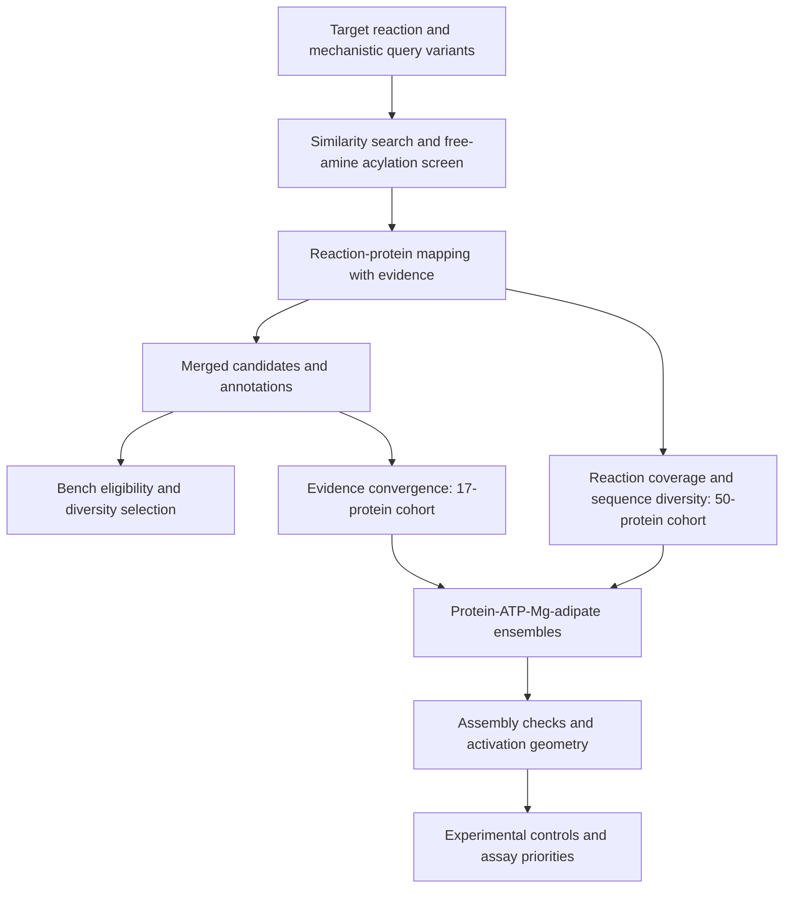

# Pipeline stage index

Generated from `amide_synthesis/stages.py`. The detailed methods are in [PIPELINE.md](../PIPELINE.md).

| Phase | Stage | Method | Canonical module |
|---|---|---|---|
| reaction-search | `corpus` | rebuild reactions + ECFP4/DRFP | `amide_synthesis.reaction_search.rebuild_corpus` |
| reaction-search | `search` | encode queries, cosine nearest neighbours | `amide_synthesis.reaction_search.encode_and_search` |
| reaction-search | `screen` | mechanism screens + substrate distance | `amide_synthesis.reaction_search.amide_enzymes` |
| enzyme-mapping | `enzymes` | resolve UniProt enzymes (network) | `amide_synthesis.enzyme_mapping.fetch_enzymes` |
| candidate-selection | `table` | prioritised candidate table (+ family) | `amide_synthesis.candidate_selection.candidate_table` |
| enzyme-mapping | `families` | expand validated families by domain / clade (network) | `amide_synthesis.enzyme_mapping.expand_families` |
| enzyme-mapping | `links` | join evidence-scoped Rhea links and validated equivalent equations | `amide_synthesis.enzyme_mapping.precomputed_links` |
| enzyme-mapping | `refs` | assayed panel + literature-curated proteins (network) | `amide_synthesis.enzyme_mapping.reference_actives` |
| enzyme-mapping | `neighbours` | borrow enzymes across chemically equivalent reactions | `amide_synthesis.enzyme_mapping.chemistry_neighbours` |
| enzyme-mapping | `names` | candidates named for the target function in UniProt (network) | `amide_synthesis.enzyme_mapping.enzyme_names` |
| enzyme-mapping | `actives` | candidates reached from the MEASURED actives (network) | `amide_synthesis.enzyme_mapping.active_homologs` |
| enzyme-mapping | `kegg` | resolve unresolved reactions through KEGG orthology (network) | `amide_synthesis.enzyme_mapping.kegg_orthologs` |
| candidate-selection | `kinetics` | measured Km/kcat by EC from SABIO-RK (network) | `amide_synthesis.candidate_selection.kinetics` |
| candidate-selection | `ecsub` | substrate distance from each protein's own Rhea reaction (network) | `amide_synthesis.candidate_selection.ec_substrate` |
| candidate-selection | `master` | merge every route, keeping provenance | `amide_synthesis.candidate_selection.master_table` |
| candidate-selection | `enrich` | fill annotation for bare candidates; UniParc for the panel (network) | `amide_synthesis.enzyme_mapping.enrich` |
| structure-modeling | `pdb` | experimental structures per candidate (network) | `amide_synthesis.structure_modeling.pdb_evidence` |
| structure-modeling | `geometry` | adenylation geometry in cofactor-bound structures (network) | `amide_synthesis.structure_modeling.adenylation_geometry` |
| structure-modeling | `ligands` | classify crystallographically bound ligands (network) | `amide_synthesis.structure_modeling.ligand_evidence` |
| candidate-selection | `members` | discriminate members within a family (tie-break only) | `amide_synthesis.candidate_selection.member_similarity` |
| candidate-selection | `famval` | judge each family on its own seeds' chemistry (network) | `amide_synthesis.candidate_selection.family_evaluation` |
| candidate-selection | `properties` | curated kinetics / location / domains from UniProt (network) | `amide_synthesis.candidate_selection.curated_properties` |
| candidate-selection | `shortlist` | bench-ready diverse shortlist + FASTA | `amide_synthesis.candidate_selection.shortlist` |
| structure-modeling | `models` | AlphaFold confidence + curated properties on the shortlist (network) | `amide_synthesis.structure_modeling.model_quality` |
| candidate-selection | `converged` | candidates backed by several INDEPENDENT lines of evidence | `amide_synthesis.candidate_selection.converged` |
| evaluation | `dossier` | full dossier per converged candidate (network) | `amide_synthesis.evaluation.dossier` |
| evaluation | `native` | native reactions + family grouping | `amide_synthesis.evaluation.native_substrates` |
| evaluation | `deckfigs` | family and substrate-gap figures | `amide_synthesis.evaluation.deck_figures` |
| evaluation | `figure` | t-SNE map with candidates overlaid | `amide_synthesis.evaluation.project_tsne` |

The 17- and 50-protein cohorts are separate selection policies. Historical campaign inputs remain frozen.
