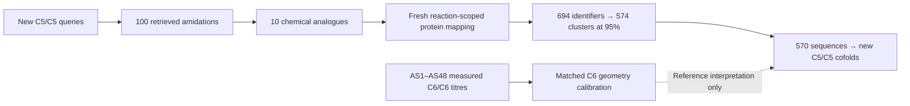

# Enzyme provenance, retained homologs and geometry–activity calibration

_Draft for colleague review · 2026-11-03 06:53 UTC · Current C5/C5 discovery plus a separate C6/C6 experimental reference_

## Main findings

The current glutarate–cadaverine discovery retains **570 modeling sequences** from 694 candidate identifiers and 574 pooled 95%-identity clusters. Every modeling sequence can now be traced to its retrieved native-reaction analogue and the annotation or homology evidence supporting that link. The full cohort is being cofolded; novelty relative to prior work does not control modeling admission.[^mapping]

All five enzymes tested by Josh's group—DdaG, SfaB, SuCphA1, McbA and PylC—are highlighted in Figure 1B using their available **adipate/HMDA reference ensembles**. Figure 1A shows the current C5/C5 candidates separately. Historical C6 models are not C5 predictions. PylC's construct failed its native-activity control, so it is not treated as a valid negative enzyme.[^five][^paper]

For the requested AS1–AS48 calibration, angle and distance show **limited evidence of quantitative titre prediction**. The proximity-weighted angle has Spearman ρ=0.275 (95% bootstrap CI -0.028 to 0.540; nominal p=0.058). The joint angle/distance model has held-out R²=-0.017, versus -0.000 for angle alone. These results do not validate a yield predictor for the new C5/C5 pair.[^assay]

## 1. Track the source reaction for every enzyme and homolog

The sequence-to-reaction mapping is an evidence graph, not a claim that every homolog has experimentally established native specificity. The [full provenance table](tables/enzyme_reaction_provenance.tsv) preserves every source edge, including multiple edges for one sequence. It includes the retrieved ModelSEED equation, UniProt native catalytic statements, evidence route, alignment reference, identity/coverage, exact-sequence representative and 95% cluster representative. The [cofold-to-reaction table](tables/cofold_sequence_reaction_links.tsv) links each actual modeled sequence to its source reaction(s), distinguishing its own source assignment from the assignment of a cluster member.[^mapping]

**Native-reaction annotation** means the sequence has an annotation scoped to the corresponding Rhea reaction. **Inferred or related** means EC/name/homology evidence, without an established exact assignment to the retrieved equation. Neither category establishes activity on glutarate plus cadaverine. The glycylglycine branch is specifically exploratory: its related L-amino-acid ligases must not be renamed experimentally established glycylglycine synthases.[^mapping]

## 2. How many homologs remain at 95% identity?

The table reports the clustering actually used in this campaign: identical sequences are collapsed, followed by greedy 95% sequence-identity clustering with at least 90% aligned coverage of both sequences. Clustering is pooled across the candidate set. “Native annotated” is an accession count before clustering, not the number of experimentally proven target catalysts.[^mapping]

| reaction   |   raw_accessions |   exact_sequences |   clusters95 |   cofold_sequences |   native_annotation_accessions |
|:-----------|-----------------:|------------------:|-------------:|-------------------:|-------------------------------:|
| rxn05123   |              606 |               594 |          495 |                495 |                              4 |
| rxn46045   |                6 |                 6 |            6 |                  6 |                              1 |
| rxn22343   |                6 |                 6 |            6 |                  6 |                              1 |
| rxn42510   |                2 |                 2 |            1 |                  1 |                              1 |
| rxn47618   |               11 |                11 |           11 |                 11 |                              1 |
| rxn21038   |               33 |                32 |           26 |                 21 |                              1 |
| rxn42395   |                9 |                 9 |            9 |                  9 |                              1 |
| rxn45007   |               10 |                10 |           10 |                 10 |                              1 |
| rxn09897   |               11 |                11 |           10 |                 11 |                              0 |
| rxn13979   |                0 |                 0 |            0 |                  0 |                              0 |

The nine mapped native-reaction groups reconcile to 574 clusters and 570 cofold sequences. Five fragment clusters in the AsbA group are excluded (26 → 21); one additional curated L-amino-acid-ligase reference is protected after clustering (10 → 11). The targeted cadaverine query also supports two proteins already represented in the glutamyl-amine group and is not counted as an extra native reaction. The phosphinothricin-tripeptide equation (`rxn13979`) supplies no justified standalone free-acid/diamine catalyst: three carrier-dependent context records are retained separately.[^mapping]

The equations and all per-reaction counts are in [reaction_95_counts.tsv](tables/reaction_95_counts.tsv). This gives the number of homolog representatives to consider cofolding per reaction without losing source attribution or counting the same substrate-query support twice.

## 3. Include the five tested enzymes in angle versus distance

**Figure 1.** Each point summarizes 50 predicted poses. Panel A is the current C5/C5 snapshot (108 verified stage-1 ensembles); panel B is the matched C6/C6 reference space, with all five tested enzymes highlighted. Distances and angles for the five references were recomputed directly from their retained coordinate ensembles using the same formulas as the assay-panel analysis. The 4 Å and 150° lines are geometric guides, not validated activity decision boundaries. Reference ensembles have differing historical protonation, metal and numerical protocols; they are illustrative controls rather than a calibrated cross-family ranking.[^five]

| enzyme   | accession   |   weighted_angle_deg |   harmonic_distance_A |   close_poses |
|:---------|:------------|---------------------:|----------------------:|--------------:|
| DdaG     | E2JA32      |               96.160 |                 4.510 |             3 |
| SfaB     | A0A2H4T912  |              100.098 |                12.289 |             1 |
| SuCphA1  | P73833      |              162.120 |                 5.842 |             0 |
| McbA     | R4R1U5      |              150.237 |                 6.583 |             4 |
| PylC     | Q46E79      |              147.318 |                 5.151 |             1 |

DdaG and SfaB have reported nylon-diad activity; SuCphA1 and McbA had no detectable products under the reported assay conditions. PylC remains uninterpretable because the soluble construct failed the native-activity control. These controls demonstrate why a single geometric score should not be assumed to transfer quantitatively across enzyme families.[^paper]

**C5 reference coverage:** the five reference enzymes do not yet have verified stage-1 C5 ensembles in the current snapshot. They are deliberately not placed on the current C5 axes using C6 coordinates. If the desired figure is a single, fully matched C5 comparison containing all five controls, fresh C5 cofolds for the missing references are an additional work item; this draft supplies the available reference comparison explicitly.

## 4. Does angle plus distance correlate with the homolog titres?

The supplied file contains **48 sequenced homologs (AS1–AS48), one SfaB control and one BL21 blank**. The primary analysis uses the 48 homologs; a sensitivity analysis includes SfaB (n=49). All 48 homolog input sequences match the assay sequences exactly. The measured outcome is **N66L1 product titre in µg/mL for adipate/HMDA**, not percent molar yield. Therefore these rows are not pooled with literature percentage yields or with current C5 predictions.[^assay]

**Figure 2.** Left: angle–distance geometry for the 48 homologs, colored by measured titre; AS9, AS17 and AS23 are the three ≥0.5 µg/mL producers. Right: held-out predictions from angle-only and joint angle/distance models. Each held-out row is one enzyme; its 50 stochastic poses are not independent experimental samples.

### Definitions and statistical approach

For distance dᵢ from an adipate oxygen to the reactive ATP phosphorus and attack angle θᵢ, the reported proximity-weighted angle is θw = Σ(θᵢ/dᵢ) / Σ(1/dᵢ). Absolute proximity is represented separately by the harmonic distance dH = 50 / Σ(1/dᵢ). A high θw can occur even if every pose is distant, so it cannot replace dH or the count of close poses.

The prespecified strict joint fraction is the proportion with d < 4 Å and θ > 150°. A smooth joint descriptor uses sigmoid((3.5−d)/0.5) × exp[−0.5((θ−180)/30)²], averaged over poses. No threshold, pseudocount or ridge parameter was optimized on these outcomes. Rank correlations use enzyme-level bootstrap confidence intervals (2,000 resamples) and Benjamini–Hochberg adjustment across the four feature tests. Because titres are highly skewed and have only three strong producers, rank-based effect estimates and held-out performance are emphasized rather than a normal-response significance claim.

### Direct feature–titre associations: 48 homologs

| feature              |   spearman_rho |   ci95_low |   ci95_high |   nominal_p |   BH_q |
|:---------------------|---------------:|-----------:|------------:|------------:|-------:|
| weighted_angle_deg   |          0.275 |     -0.028 |       0.540 |       0.058 |  0.234 |
| harmonic_distance_A  |          0.061 |     -0.264 |       0.390 |       0.682 |  0.691 |
| near_attack_fraction |          0.062 |     -0.257 |       0.385 |       0.675 |  0.691 |
| smooth_joint_support |          0.059 |     -0.262 |       0.384 |       0.691 |  0.691 |

### Joint angle/distance: leave-one-enzyme-out prediction

The response is log10(titre + 0.01), with 0.01 µg/mL fixed in advance. Predictors are standardized inside each training fold; ridge alpha is fixed at 1. The joint model uses θw and log(dH). The mean-only model is a held-out baseline. Negative held-out R² indicates worse squared-error prediction than a constant reference, not a negative biological yield.

| model               |   loocv_rmse |   loocv_r2 |   loocv_spearman |   strong_producer_auroc |
|:--------------------|-------------:|-----------:|-----------------:|------------------------:|
| mean_baseline       |        0.609 |     -0.043 |           -1.000 |                   0.000 |
| angle_only          |        0.596 |     -0.000 |            0.158 |                   0.726 |
| distance_only       |        0.609 |     -0.041 |           -0.297 |                   0.148 |
| angle_plus_distance |        0.601 |     -0.017 |            0.145 |                   0.733 |

The [49-enzyme sensitivity results](tables/cross_validation.tsv) and [all feature correlations](tables/feature_correlations.tsv) retain the SfaB-control analysis. Complete observed and held-out values are in [held_out_predictions.tsv](tables/held_out_predictions.tsv). The descriptive associations and any AUROC values are exploratory: only three strong producers are available, homologs can remain dependent, and leave-one-enzyme-out evaluation does not establish generalization to a new enzyme family or substrate pair. High geometry scores identify candidates for testing; these data do not support reliable quantitative yield prediction.

## Review comments and next decisions

- Confirm whether Figure 1's separate substrate-matched reference panels meet the intended comparison, or whether all five controls should receive new C5 cofolds for one matched C5 panel.
- Decide whether homolog sampling should cover all 570 retained sequences (the current queue) or a prospectively declared, reaction-balanced subset for a subsequent experimental round. Do not retrospectively select a favorable assay subset to improve correlation.
- Confirm any assay-specific detection limits before replacing very small measured titres with censored values. This draft retains the supplied means and does not treat reconstructed literature replicates as new observations.
- Keep the C6 calibration and C5 discovery conclusions separate until matched C5 activity measurements are available.

## Source and data references

[^mapping]: Frozen current-campaign mapping: `mapping/reaction_candidates.tsv`, `cluster_membership.tsv`, `fold_candidates.tsv` and reaction-selection tables under `results/glutarate_cadaverine_fresh_20261102/`. Portable exports are included in this draft's `tables/` directory; exact source paths and SHA256 hashes are recorded in `manifest.json`.
[^five]: Retained ensembles under `results/five_tested_enzymes_cofolds/ensembles/` and their protocol notes. Recomputed per-pose reference measurements are in [five_reference_pose_geometry.tsv](tables/five_reference_pose_geometry.tsv); enzyme summaries and protocol qualifications are in [five_reference_enzymes.tsv](tables/five_reference_enzymes.tsv).
[^assay]: Local source: `Enzyme_agent/exp_data/amide_synthetase/assay_data/panel_activity.csv`; matched geometry: `structural_proxies/tables/continuous_pose_geometry.csv`. [Matched enzyme-level dataset](tables/matched_assay_geometry.tsv), [sequence checks](tables/panel_sequence_checks.tsv), and [diagnostics](tables/panel_diagnostics.json) accompany this draft. This is the AS1–AS48 panel confirmed by the requester.
[^paper]: Qian et al., *Improved nylon polymerization using amide diads*, Green Chemistry (2026), [doi:10.1039/D6GC00885B](https://doi.org/10.1039/D6GC00885B). The paper is used for reference-enzyme assay interpretation, not as a source of new C5 measurements for the homolog panel.
